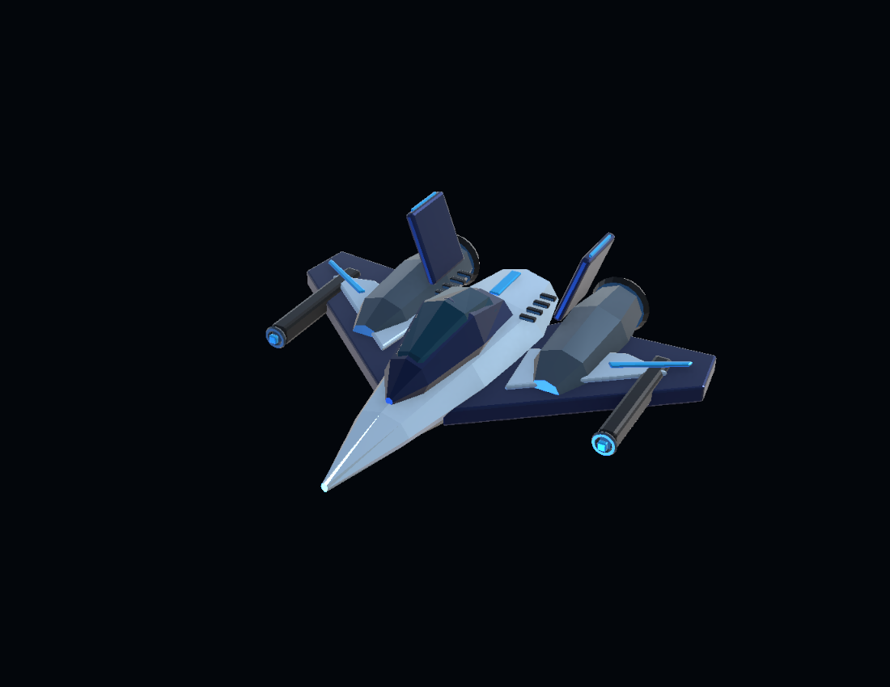
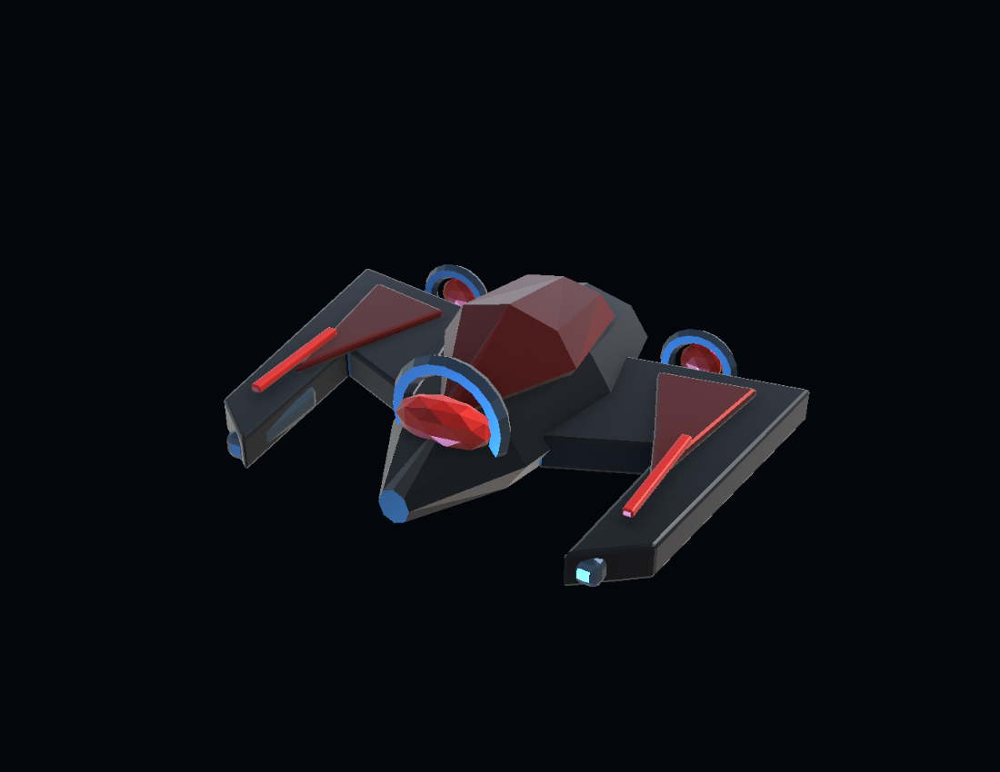
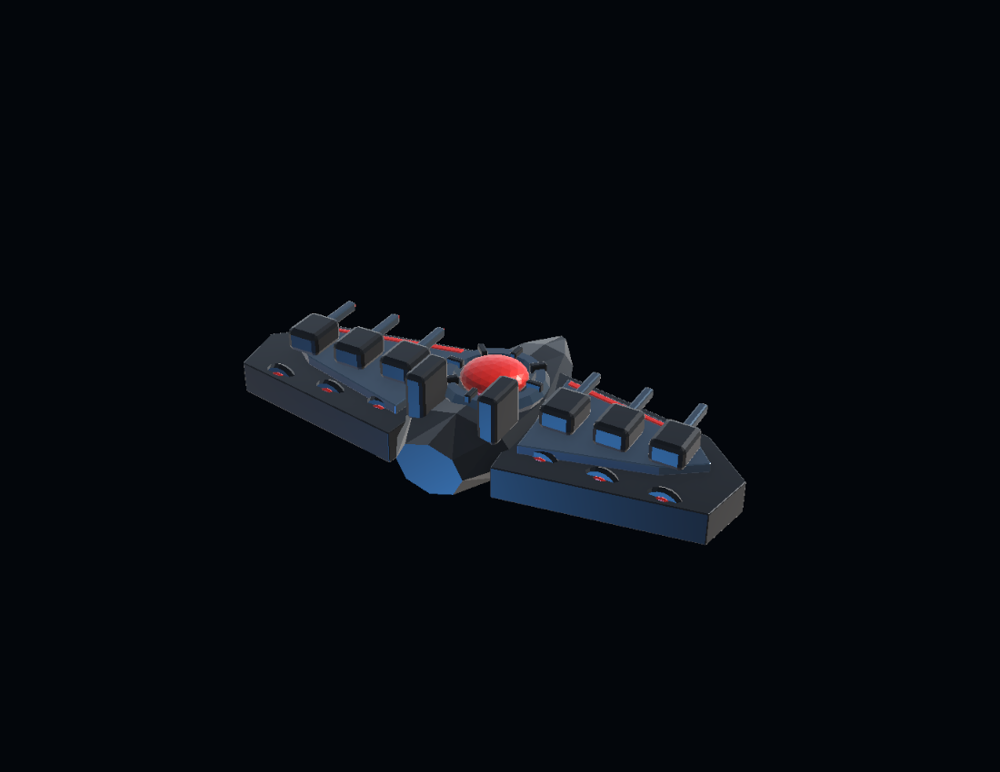

# NEBULA DEFENDER

### Galactic Assault · Vuelve a casa

Shooter espacial arcade 3D para Windows. Pilota **Aurora**, despeja tres sectores y cruza sus portales de salto para regresar a casa. Destruye asteroides que se fragmentan, esquiva drones y derrota a **Nemesis Prime**.

<p align="center"></p>

**Individual · Sin conexión · Control con mouse · Tres sectores · Modelos 3D originales**

## Descargar y jugar

**[Descargar instalador Windows](https://github.com/azucardefrutas/nebula-defender/releases/download/v1.0.0/NebulaDefender-Setup-x64.exe)** · **[Todas las descargas](https://github.com/azucardefrutas/nebula-defender/releases/tag/v1.0.0)**

| Descarga | Uso |
| --- | --- |
| [Instalador Windows x64](https://github.com/azucardefrutas/nebula-defender/releases/download/v1.0.0/NebulaDefender-Setup-x64.exe) | Opción recomendada. Juego completo, accesos directos y desinstalador. No requiere Unity ni Visual Studio. |
| [Windows portable](https://github.com/azucardefrutas/nebula-defender/releases/download/v1.0.0/NebulaDefender-Windows-x64.zip) | Extrae todo y abre `Windows/NebulaDefender.exe`. Conserva sus datos y bibliotecas. |
| [Versión web local](https://github.com/azucardefrutas/nebula-defender/releases/download/v1.0.0/NebulaDefender-Web-Local.zip) | Extrae y abre `JUGAR_LOCALHOST.cmd`. Requiere Python 3.10 o posterior y navegador con WebGL 2. |
| [Proyecto Unity completo](https://github.com/azucardefrutas/nebula-defender/releases/download/v1.0.0/NebulaDefender-Unity-Source.zip) | Código, escenas, prefabs, materiales, fuentes Blender, FBX, audio, pruebas, herramientas y documentación. |
| [SHA256SUMS.txt](https://github.com/azucardefrutas/nebula-defender/releases/download/v1.0.0/SHA256SUMS.txt) | Hashes para comprobar las cuatro descargas. |

La plataforma nativa es **Windows x64**; esta entrega no incluye APK ni ejecutables nativos para ARM64, macOS o Linux. Web se ejecuta en `http://localhost:8080`, no en una página alojada en Internet. Su paquete incluye el ZIP de Windows para que también funcione el botón de descarga local.

## Tu misión

1. Pulsa **JUGAR**. Registrar un piloto es opcional.
2. Destruye los objetivos indicados en el HUD. Los fragmentos también cuentan.
3. Entra en el centro del **portal azul** para completar el sector.
4. Continúa, derrota a Nemesis Prime y cruza el último portal para volver a casa.

Tienes tres vidas, salud, escudo temporal y mejoras de disparo. El vuelo no tiene paredes ni saltos entre bordes. Las amenazas se mantienen cerca de tu zona de combate.

| Control | Acción |
| --- | --- |
| Mouse | Apuntar |
| Clic izquierdo | Disparar |
| Mantener clic derecho | Avanzar; al soltar, frenar con asistencia |
| Rueda / Shift | Activar escudo |
| WASD / flechas | Propulsión, frenado y giro alternativos |
| Espacio | Disparar con teclado |
| Esc | Pausar / continuar |
| C | Cambiar cámara |
| F1 | Guía |

El invitado puede jugar toda la campaña. Selecciona un piloto para conservar estadísticas y marcas. El ranking es **local a cada computadora**; Windows y el navegador guardan sus perfiles por separado. [Controles completos](Documentation/CONTROLS.md).

## Arte original

Siete modelos propios creados con **Blender 5.1.2** e importados como FBX: Aurora, Marauder, Nemesis y cuatro asteroides con cráteres. Se incluyen los `.blend` editables. Cabina elevada, alas con grosor, motores y cañones separados visualmente, blindaje metálico y reactor animado del jefe.

| Marauder | Nemesis Prime |
| --- | --- |
|  |  |

Las imágenes son renderizados de las mallas importadas en Unity. [Fuentes y generación](Documentation/ORIGINAL_ART.md) · [Inventario](Documentation/ASSET_INVENTORY.md).

## Abrir el proyecto

1. Clona el repositorio o extrae el ZIP del proyecto.
2. Añade la carpeta a Unity Hub y abre con **Unity 6.3 LTS — 6000.3.15f1**, con licencia válida.
3. Abre `Assets/Nebula/Generated/Scenes/CoreSandbox.unity` y pulsa Play para volar directamente, o `Campaign.unity` para la campaña.

Las escenas, prefabs y referencias ya están incluidos. **Tools → Nebula Defender → Generate Demo** regenera los recursos básicos; **Install Original Art** integra los modelos propios. Guarda las escenas/modelos personalizados fuera de `Generated`. No necesitas Blender para usar los FBX existentes.

La primera restauración de paquetes puede requerir Internet; los jugadores compilados funcionan offline. Fuente y Windows utilizan Unity 6.3/URP 17.3. Web se compila en una copia aislada con Unity 6.4/URP 17.4, conservando el proyecto principal.

## Tecnología y estructura

**C# · Unity Physics 3D · URP · Input System · uGUI/TextMeshPro · Unity Test Framework**

```text
Assets/Nebula/
  Scripts/       Movimiento, combate, niveles, UI y guardado
  Editor/        Generación, importación y compilación
  Generated/     Escenas, prefabs, balance y sectores
  Art/           FBX y materiales
  Audio/         Música y efectos sintetizados
  Tests/         EditMode y PlayMode
ArtSource/       Siete fuentes editables de Blender
Tools/           Compilación, empaquetado y servidor local
Documentation/  Diseño, arquitectura, pruebas y evidencias
```

Modelos separados de Rigidbody/colliders; proyectiles reutilizables; daño único por impacto; fragmentación finita; presupuestos de objetos; perfiles JSON versionados con respaldo y escritura atómica. Sin backend ni clasificación global. [Arquitectura](Documentation/ARCHITECTURE.md).

## Validación y alcance

Se conservan **30/30 PlayMode aprobadas** con el arte actual y **20/20 EditMode** de reglas/guardado. Se verificaron 292 objetos/referencias y los siete FBX. Windows y Web compilaron sin errores ni advertencias de build. Instalación y desinstalación reales comprobaron hashes de 161 archivos y preservaron un archivo ajeno y el registro del usuario.

En localhost se revisaron menú, modelos, vuelo, movimiento y proyectiles; la consola mostró una advertencia del shader opcional FSR. La revisión visual de esta versión se realizó en Unity y Web: el jugador nativo arrancó, pero su apariencia no pudo certificarse con la captura disponible. Faltan campaña humana completa, escucha, controles físicos en Windows, prueba físicamente desconectada y rendimiento sostenido en el equipo de exposición. No se afirma una tasa de 60 FPS medida.

**[Informe de pruebas](Documentation/TEST_REPORT.md)** · [Entrega 1.0.0](Documentation/RELEASE-1.0.0.md)

## Documentación

- [Diseño](Documentation/GAME_DESIGN_DOCUMENT.md) · [Sectores](Documentation/LEVELS.md).
- [Compilar Windows](Documentation/BUILD_WINDOWS.md) · [Web local](Documentation/BUILD_WEB.md).
- [Desarrollo local](Documentation/LOCAL_DEVELOPMENT.md) · [Modelos originales](Documentation/ORIGINAL_ART.md).
- [Progreso](Documentation/PROGRESS.md) · [Avisos de terceros](THIRD_PARTY_NOTICES.md).

Proyecto académico para la **Semana de Ciencia y Tecnología 2026, Universidad Politécnica de Bacalar**. Docente: **Mtro. Esdras Chuc C.** Nebula Defender es independiente de Dead Tap.
